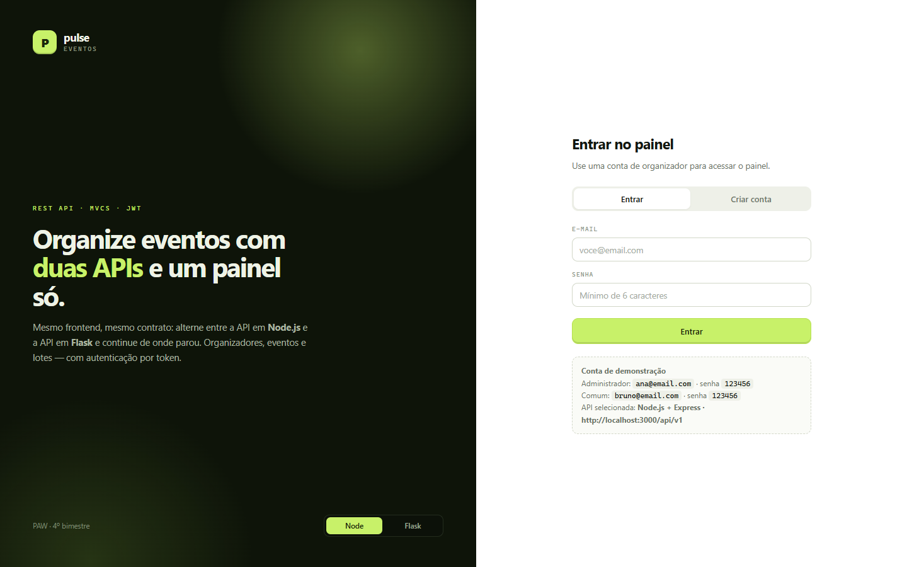
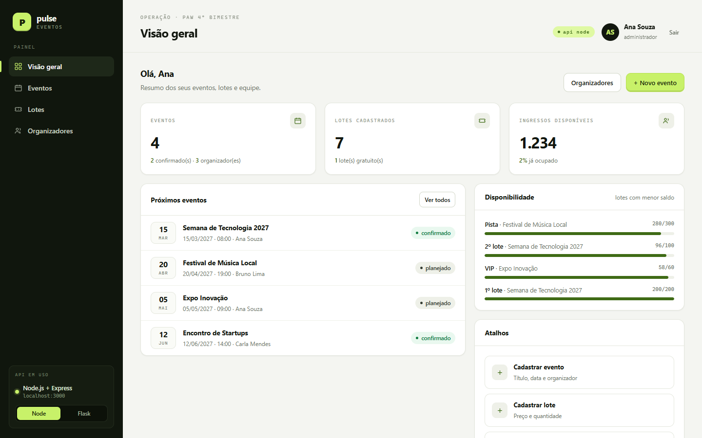
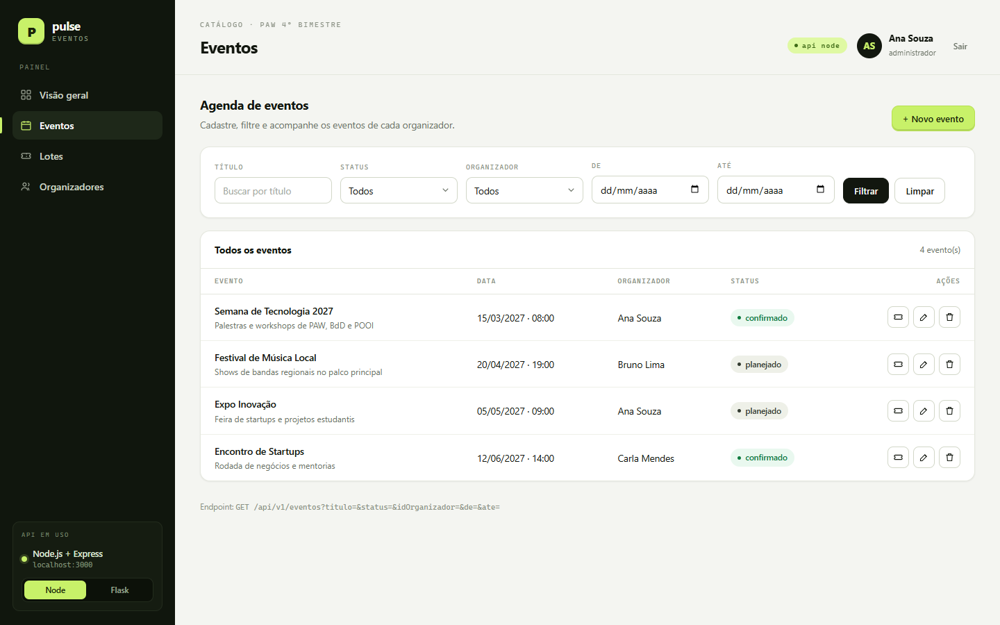
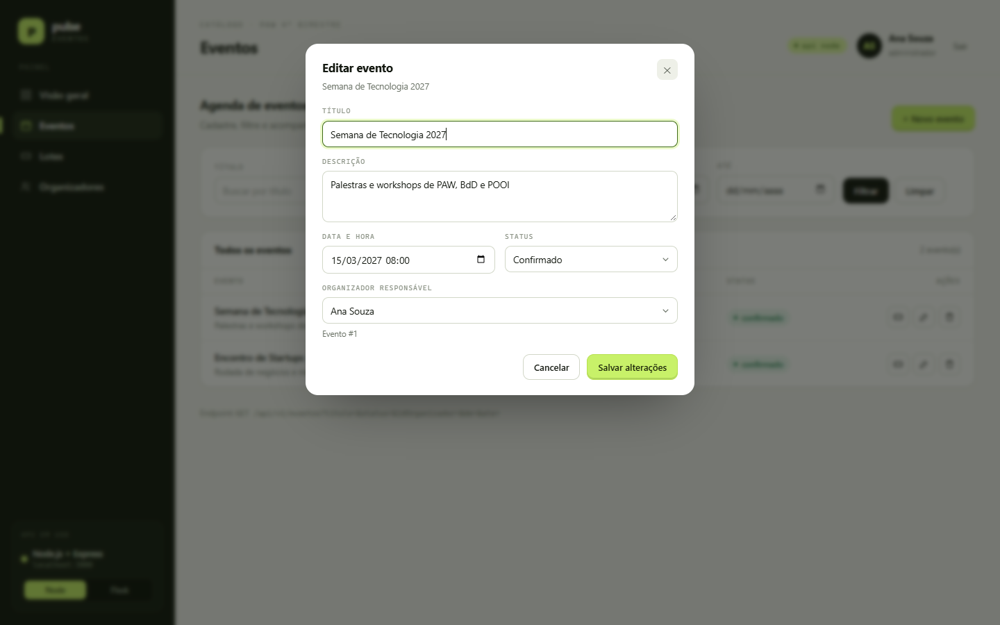
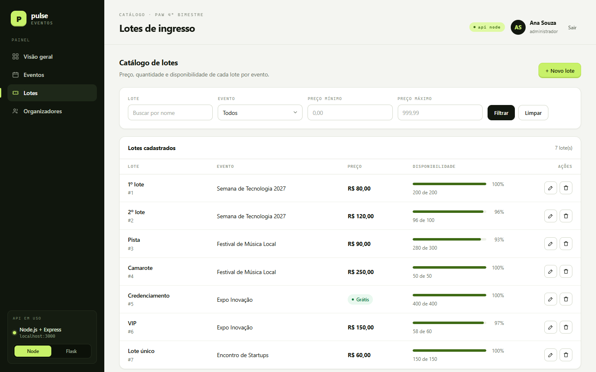
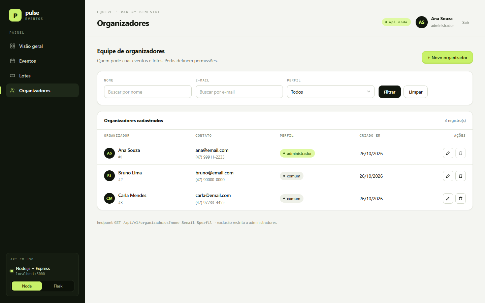

# Projeto 4º Bimestre — PAW — Gestão de Eventos com duas REST APIs + frontend único

Projeto do 4º bimestre da disciplina de **Programação de Aplicações Web (PAW)**: o mesmo
domínio de eventos do bimestre anterior, mas agora com **três tabelas novas e relacionadas**,
**duas REST APIs independentes** (JavaScript e Python) com **autenticação JWT** e **um único
frontend CRUD** que alterna entre as duas APIs.

## O que a ficha pede e onde está

| Item da ficha | Onde está | Valor |
|---|---|---|
| **(4 pts)** REST API em **JavaScript** com CRUD completo das 3 tabelas + JWT | `js-api/` — Node.js + Express, MVCS + DAO, `src/roteador`, `src/controle`, `src/servico`, `src/dao` | 4,0 |
| **(4 pts)** REST API em **Flask** com CRUD completo das 3 tabelas + JWT | `flask-api/` — Flask, mesmas camadas (`api/router`, `api/control`, `api/service`, `api/dao`) | 4,0 |
| **(2 pts)** **1 frontend** CRUD completo com **filtros para cada uma das 2 APIs** | `frontend/` — `login.html`, `index.html`, `eventos.html`, `lotes.html`, `organizadores.html` | 2,0 |

As duas APIs expõem **exatamente o mesmo contrato** (mesmas rotas, mesmos payloads, mesmos
códigos de status e mesmas mensagens de erro) — por isso o mesmo frontend funciona nas duas.
Os itens 1, 2 e 3 também podem ser apresentados no **Insomnia**: a coleção pronta está em
[`docs/insomnia.json`](docs/insomnia.json).

## Tema escolhido (3 tabelas relacionadas)

```
organizadores 1 --- N eventos 1 --- N lotes
```

- **organizadores** — quem opera a plataforma. É também a tabela de **autenticação** (e-mail
  único + senha com hash **bcrypt** + `perfil` `administrador`/`comum`).
- **eventos** — cada evento pertence a **um** organizador (`id_organizador`), com data/hora,
  descrição e status (`planejado`, `confirmado`, `realizado`, `cancelado`).
- **lotes** — cada lote de ingressos pertence a **um** evento (`id_evento`), com preço,
  quantidade total e quantidade disponível (`disponivel <= total`).

Nenhuma tabela de exemplo de aula foi reutilizada: não existem `funcionarios`/`cargos`
(exemplo do professor) nem as tabelas do projeto do 3º bimestre
(`locais`, `participantes`, `ingressos`, `compras`). O **tema (domínio) de eventos** é o
mesmo do projeto do 3º bimestre, como autorizado, mas as **três tabelas são novas** e a
**identidade visual e todas as telas foram refeitas**.

## Estrutura de pastas

```
projeto/
├── docs/
│   ├── banco.sql            # cria o banco paw4bi_eventos + seed (senhas: 123456)
│   ├── insomnia.json        # coleção para testar as duas APIs
│   ├── roteiro-testes.md    # roteiro de testes executado (API + frontend)
│   ├── testes/teste-api.js  # 33 verificações automáticas do contrato (roda nas 2 APIs)
│   ├── ficha-avaliacao.docx # ficha do bimestre (impressa para a apresentação)
│   └── *.png                # prints das telas (desktop e mobile)
├── frontend/                # frontend único (HTML + CSS + JS puro), servido pelas 2 APIs
│   ├── login.html           # login + criar conta + escolha da API
│   ├── index.html           # dashboard (contadores)
│   ├── organizadores.html   # CRUD + filtros (nome, e-mail, perfil)
│   ├── eventos.html         # CRUD + filtros (título, status, organizador, período)
│   ├── lotes.html           # CRUD + filtros (nome, evento, faixa de preço)
│   ├── css/style.css
│   └── js/                  # ApiService, Sessao, UI, layout e um módulo por página
├── js-api/                  # API 1 — Node.js + Express (porta 3000)
│   ├── app.js  Servidor.js
│   └── src/{config,modelo,dao,database,servico,controle,roteador,middleware,http,utils}
└── flask-api/               # API 2 — Python + Flask (porta 8080)
    ├── app.py  server.py  requirements.txt
    └── api/{config,model,dao,database,service,control,router,middleware,http,utils}
```

## Requisitos

- **Node.js 18+** (testado com Node 24) e npm
- **Python 3.10+** (testado com 3.11) e pip
- **MySQL 8** ou **MariaDB** (XAMPP serve)

## Como rodar

### 1. Banco de dados

```bash
mysql -u root -p < docs/banco.sql
```

O script **recria** o banco `paw4bi_eventos` com 3 organizadores, 4 eventos e 7 lotes.
Todas as senhas do seed são `123456`.

### 2. API JavaScript (porta 3000)

```bash
cd js-api
npm install
npm start          # ou: node app.js
```

### 3. API Flask (porta 8080)

```bash
cd flask-api
pip install -r requirements.txt
python app.py      # ou: python server.py
```

A conexão está fixa no código, como nos exemplos da aula: `127.0.0.1:3306`, `root`, sem senha,
banco `paw4bi_eventos` (`js-api/src/config/config.js` e `flask-api/api/config/config.py`).
Se o seu MySQL usar outro usuário/senha, ajuste essas duas constantes.

No XAMPP: inicie o módulo **MySQL** no painel de controle do XAMPP antes de rodar as APIs.

### 4. Frontend

Não precisa de servidor separado: **as duas APIs servem o próprio frontend**.

- Pela API Node: <http://localhost:3000/login.html>
- Pela API Flask: <http://localhost:8080/login.html>

Abra qualquer uma das duas e use o seletor **Node / Flask** (canto do login ou da barra
lateral) para alternar a API em uso sem sair da sessão.

### 5. Contas do seed

| E-mail | Senha | Perfil |
|---|---|---|
| `ana@email.com` | `123456` | administrador |
| `bruno@email.com` | `123456` | comum |
| `carla@email.com` | `123456` | comum |

Também é possível criar conta na aba **Criar conta** do login (o cadastro público cria
sempre perfil `comum`).

## Login + JWT (fluxo resumido)

1. O frontend envia `POST /api/v1/auth/login` com `{"organizador": {"email", "senha"}}`.
2. A API confere a senha com **bcrypt** e devolve `{"organizadores": [...], "token"}`.
3. O token é guardado no `localStorage` (`js/sessao.js`) e enviado em toda chamada como
   `Authorization: Bearer <token>` (`js/ApiService.js`).
4. Sem token, token inválido ou expirado → **401**; o frontend limpa a sessão e volta ao
   login com o aviso “Sua sessão expirou. Entre novamente.”.
5. O token dura **30 dias** e carrega `{idOrganizador, nome, email, perfil}`.
6. As duas APIs usam a **mesma chave JWT**: o token emitido pela API Node vale na API Flask
   e vice-versa (útil na apresentação).

## Perfis e permissões

| Ação | `comum` | `administrador` |
|---|---|---|
| Ler qualquer recurso (GET) | ✅ com token | ✅ com token |
| CRUD de **eventos** e **lotes** | ✅ | ✅ |
| Listar organizadores / editar **o próprio** cadastro | ✅ | ✅ |
| Criar organizador (`POST /organizadores`) | ❌ 403 | ✅ |
| Editar/excluir **outro** organizador | ❌ 403 | ✅ |
| Excluir o próprio cadastro | ❌ 400 | ❌ 400 |
| Promover/rebaixar perfil (`perfil` no PUT/POST) | ❌ (campo ignorado/forçado) | ✅ |

## Regras de negócio (as duas APIs aplicam as mesmas)

**organizadores**

- `nome` 3–120, `email` válido e **único** (409 se repetir), `senha` 6–72 (hash bcrypt),
  `telefone` opcional até 20, `perfil` ∈ {`administrador`, `comum`}.
- O cadastro público (`/auth/registrar`) força perfil `comum`.
- Excluir organizador **com eventos** → **409** (“Exclua ou transfira os 1 evento(s)…”).

**eventos**

- `titulo` 3–150 e **único na mesma data/hora** (409), `dataEvento` **não pode estar no
  passado** (400), `status` ∈ {`planejado`, `confirmado`, `realizado`, `cancelado`},
  `idOrganizador` precisa existir (400).
- Excluir evento **com lotes** → **409** (“Exclua os 2 lote(s) deste evento…”).

**lotes**

- `nome` 2–80 e **único dentro do evento** (409), `preco` 0–999999.99,
  `quantidadeTotal` 1–1.000.000, `quantidadeDisponivel` opcional (padrão = total) e
  **nunca maior que o total** (400), `idEvento` precisa existir (400).

Toda resposta segue o mesmo envelope, inclusive os erros:

```json
{ "success": true,  "message": "Executado com sucesso", "data": { "eventos": [ ... ] } }
{ "success": false, "message": "Evento duplicado", "data": { "mensagem": "Já existe um evento com este título nesta data/hora." } }
```

Contrato completo (rotas, payloads, filtros, exemplos `curl`) em **[API.md](API.md)**.

## Frontend

- **login.html** — entrar / criar conta, escolha da API (Node ou Flask) e aviso de sessão
  expirada. Identidade própria: sidebar escura, acento verde-limão, cards claros e
  micro-labels monoespaçadas.
- **index.html** — dashboard com contadores e resumo (eventos por status, lotes gratuitos,
  ingressos disponíveis, próximos eventos).
- **organizadores.html** — CRUD + filtros por nome, e-mail e perfil. Para o perfil `comum` o
  botão “+ Novo organizador” fica oculto e só o próprio cadastro é editável.
- **eventos.html** — CRUD em modal + filtros por título, status, organizador e período
  (`de`/`ate`), atalho para os lotes do evento.
- **lotes.html** — CRUD em modal + filtros por nome, evento e faixa de preço, com barra de
  ocupação (`disponivel / total`).

O frontend não usa framework: `js/ApiService.js` (cliente HTTP com Bearer), `js/sessao.js`
(API escolhida + token + usuário), `js/ui.js` (toasts, modais, badges, formatação),
`js/layout.js` (sidebar/topbar comuns) e `js/paginas/*.js` (um módulo por tela).

## Prints das telas

| Login | Dashboard |
|---|---|
|  |  |

| Eventos + filtros | Modal de cadastro |
|---|---|
|  |  |

| Lotes (ocupação) | Organizadores |
|---|---|
|  |  |

Mobile (390×844): [login](docs/08-mobile-login.png) ·
[dashboard](docs/09-mobile-dashboard.png) · [eventos](docs/10-mobile-eventos.png) ·
[lotes](docs/11-mobile-lotes.png) ·
[tabela de eventos rolando](docs/12-mobile-eventos-tabela.png).

## Testes

Teste automatizado do contrato (roda igual nas duas APIs, limpa o que cria):

```bash
BASE=http://localhost:3000/api/v1 node docs/testes/teste-api.js    # Node.js
BASE=http://localhost:8080/api/v1 node docs/testes/teste-api.js    # Flask
```

No **PowerShell**:

```powershell
$env:BASE='http://localhost:3000/api/v1'; node docs/testes/teste-api.js
$env:BASE='http://localhost:8080/api/v1'; node docs/testes/teste-api.js
```

O roteiro completo (API das duas linguagens + frontend no navegador) está em
[`docs/roteiro-testes.md`](docs/roteiro-testes.md). Resumo: **33 verificações de API em cada
linguagem** (autenticação, CRUD, filtros, conflitos 409, validações 400, permissões 403, 404
JSON) e o **fluxo completo do frontend** (login, sessão expirada, dashboard, CRUD e filtros
das três telas, troca Node↔Flask com o mesmo token, bloqueios de permissão e de regra de
negócio).
