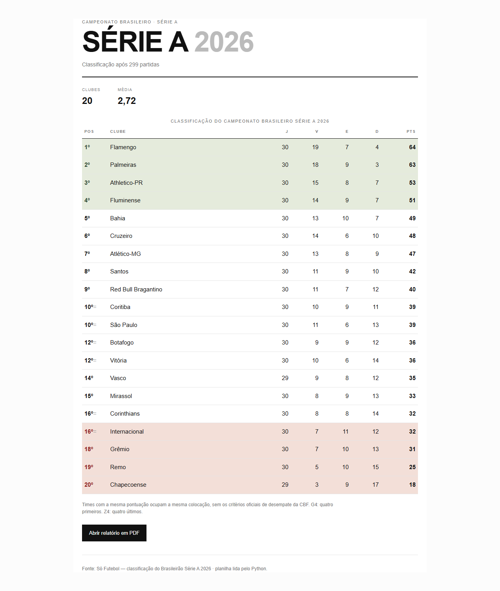
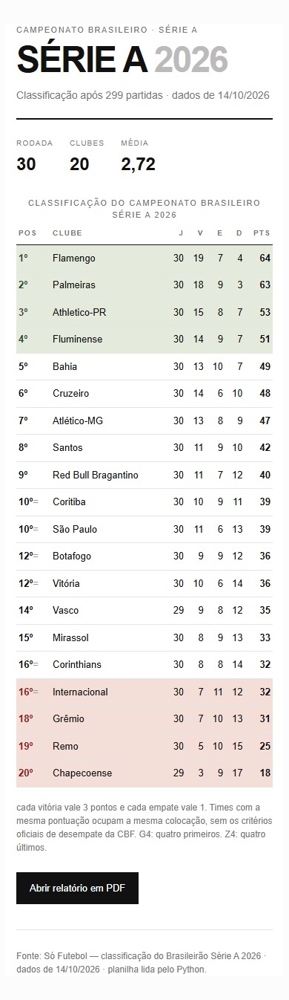
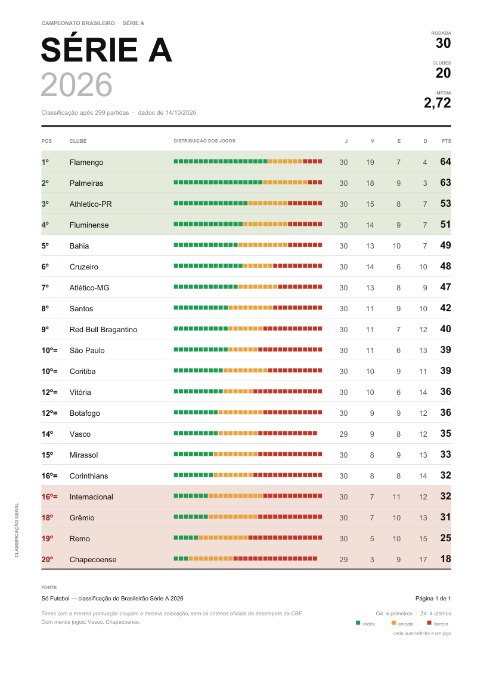

# POOI — 4º bimestre · Brasileirão Série A 2026

Página web + **1 relatório em PDF** com a classificação do Campeonato Brasileiro, lida de uma planilha Excel.

O programa foi feito para o projeto do 4º bimestre de **Programação Orientada a Objetos**: usa arquivos texto (item 38), o canvas do **reportlab** (item 39) e **pandas/openpyxl** (item 40) da apostila.



---

## O que o programa faz

1. Lê a planilha `.xlsx` da CBF (a planilha indicada pelo professor ou a de exemplo em `planilha/projeto4bi.xlsx`).
2. Calcula os pontos: **vitória = 3, empate = 1, derrota = 0**.
3. Ordena da maior para a menor pontuação e define a posição de cada clube.
4. Gera:
   - `classificacao.html` — a página web;
   - `relatorio.pdf` — o relatório;

> Na apresentação, o professor pode indicar outra planilha. Basta informar o caminho quando o programa perguntar. A planilha **não é alterada**: o programa só lê.

---

## Como executar

Requisitos: Python 3.10 ou superior.

```bash
pip install -r requirements.txt
python projeto.py
```

O código está em **`projeto.py`**; o HTML fica no modelo **`modelo_pagina.txt`**, lido e preenchido pelo programa. Há também uma versão de estudo em **`projeto_comentado.py`**.

O menu interativo oferece:

```text
1 - Gerar a página web e o PDF
2 - Mostrar a classificação no terminal
0 - Sair
```

O programa é guiado por menu: informe a planilha e escolha a opção **1** para gerar a página e o PDF juntos.

Depois de gerar, abra o arquivo `classificacao.html` no navegador.

---

## Regra de classificação

- Pontos: `3 × vitórias + 1 × empates`.
- A tabela é ordenada por pontos, do maior para o menor.
- **Times com a mesma pontuação ocupam a mesma posição** (`1º`, `2º`, `2º`, `4º`…), como pede o projeto, sem os critérios oficiais de desempate da CBF. Dentro do empate, a ordem de exibição usa apenas o nome do clube — mas a posição continua igual.
- **G4**: as quatro primeiras linhas da tabela.
- **Z4**: as quatro últimas linhas da tabela.
- Como a planilha tem Vasco e Chapecoense com 29 jogos, o programa não faz média nem projeção: usa os números exatamente como estão na planilha.

### O caso da 16ª posição

Corinthians e Internacional terminam com **32 pontos** e, pela regra do projeto, os dois ficam na **16ª posição**. Como o Z4 é definido pelas quatro últimas linhas, o **Internacional** aparece no Z4 e o Corinthians não. O Z4 usa sempre as quatro últimas linhas; o programa não aplica desempate por nome nessa borda. Se o professor preferir outra interpretação, basta mudar a linha que define `time['z4']` em `projeto.py`.

---

# A página web

Arquivo: **`classificacao.html`**

- Cabeçalho editorial igual ao do PDF: “SÉRIE A 2026”, clubes e média.
- Tabela com posição, clube, jogos, vitórias, empates, derrotas e pontos.
- G4 com fundo verde-claro; Z4 com fundo vermelho-claro.
- Empates na pontuação marcados com `=`.
- Um único botão, **“Abrir relatório em PDF”**, que apenas abre o arquivo já gerado pelo Python.
- Layout simples e responsivo, com a mesma tipografia e as mesmas cores do PDF.
- A página não depende de internet: fontes do sistema e CSS embutido.



---

# O relatório

O relatório usa os mesmos dados e o mesmo cálculo da página; muda apenas a linguagem visual.

| # | Relatório | Página | Ideia visual |
|---|---|---|---|
| 07 | **Minimalista suíço** | A4 retrato | Grade rígida, posições do G4/Z4 coloridas e distribuição V/E/D dos jogos. |

### Prévia do layout

| | |
|---|---|
|  | O layout 07 reúne a grade tipográfica, as posições verdes do G4 e vermelhas do Z4 e a distribuição V/E/D de cada clube. Na página web, as linhas do G4 e do Z4 têm fundo verde/vermelho. |

O PDF e o HTML ficam na pasta do programa e são gerados novamente a cada execução.

---

# Estrutura do projeto

```text
POOI/4bi/projeto/
├── projeto.py              # código principal: dados, PDF, página e menu
├── projeto_comentado.py    # mesma versão, comentada para estudo
├── modelo_pagina.txt       # modelo HTML lido e preenchido pelo programa
├── planilha/
│   └── projeto4bi.xlsx     # planilha de exemplo da CBF
├── classificacao.html      # página gerada
├── relatorio.pdf           # relatório gerado
├── docs/                   # prévias para o README
├── requirements.txt
└── README.md
```

---

# Conteúdo do 4º bimestre aplicado

| Conteúdo da apostila | Onde aparece |
|---|---|
| **38 — Arquivos texto** (`open`, `write`, `close`) | `projeto.py` lê `modelo_pagina.txt` e grava o HTML com `open`, `read`, `write` e `close`. |
| **39 — PDF com reportlab** (`Canvas`, `setFont`, `setFillColor`, `drawString`, `setTitle`, `save`) | O layout em `projeto.py`. |
| **40 — pandas / openpyxl** (`ExcelFile`, `parse`, `sheet_names`, `iloc`) | `projeto.py` lê a planilha, encontra a linha de cabeçalho e percorre as linhas. |
| **Funções, listas, dicionários, laços, f-strings** | Em todo o `projeto.py`. |

### Comandos de desenho usados no PDF

O layout 07 usa apenas a API básica do canvas apresentada na apostila:

| Comando | Para que foi usado |
|---|---|
| `setFont` / `setFillColor` | Tipografia e cores do texto. |
| `drawString` | Nomes dos clubes, números e legendas. |
| `setTitle` / `save` | Metadados e fechamento do PDF. |

Nenhuma biblioteca web é usada para gerar PDF. O único uso de HTML/CSS é na página que o Python escreve.

O HTML é gravado com `open(..., 'w')`, `write()` e `close()`; a página declara `windows-1252` para os acentos.

---

# Observações

- **Outra planilha:** o leitor procura uma linha de cabeçalho que tenha `Time` e `Jogos`, e colunas com `Vitórias`, `Empates` e `Derrotas`. Linhas de título antes da tabela e linhas de fonte/observação depois são ignoradas. A planilha pode estar em qualquer aba.
- **Fontes:** o PDF usa as fontes internas do reportlab (Helvetica e Helvetica-Bold), sem depender de arquivos externos.

---

## Checklist do projeto

- [x] Lê a planilha Excel indicada no momento da execução.
- [x] Calcula 3 pontos por vitória e 1 por empate.
- [x] Ordena da maior para a menor pontuação.
- [x] Exibe posição, clube, jogos, vitórias, empates, derrotas e pontos.
- [x] Times empatados ocupam a mesma posição.
- [x] Destaca os 4 primeiros e os 4 últimos com cores de fundo diferentes.
- [x] Página web com botão que abre a classificação em PDF.
- [x] PDF gerado exclusivamente por Python/reportlab.
- [x] **layout 07 (Minimalista suíço)**, além do layout da página web.
- [x] Código principal, modelo HTML em txt e versão comentada.
